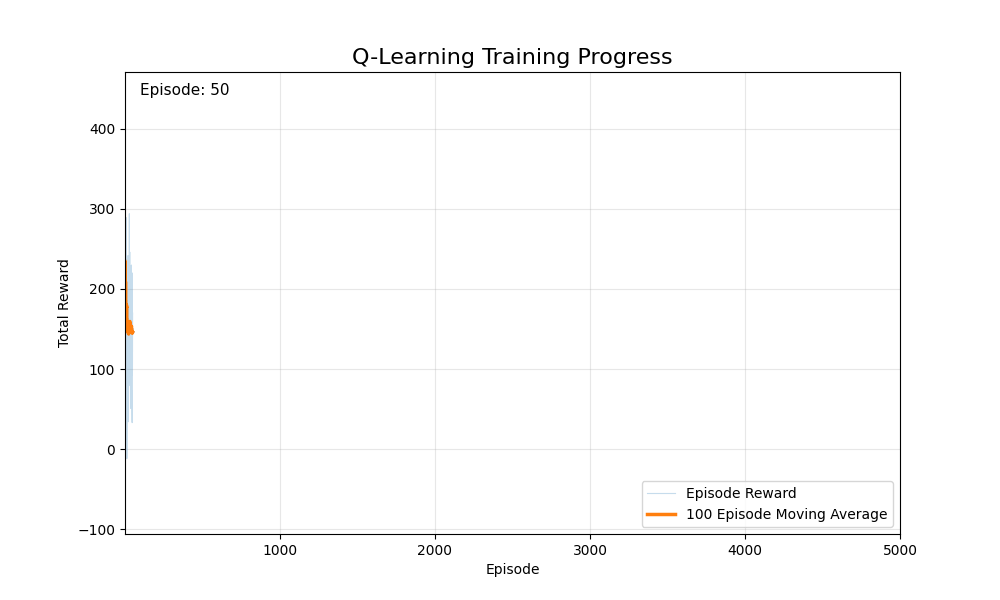
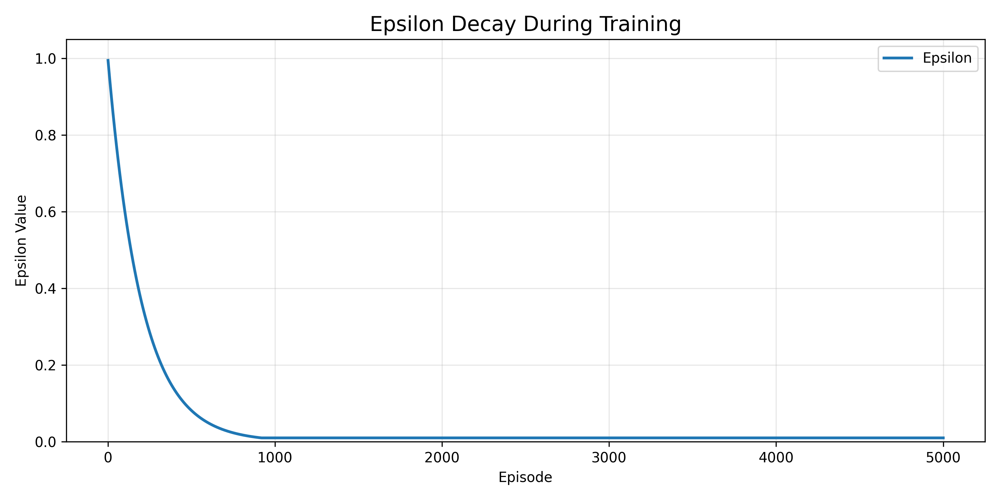
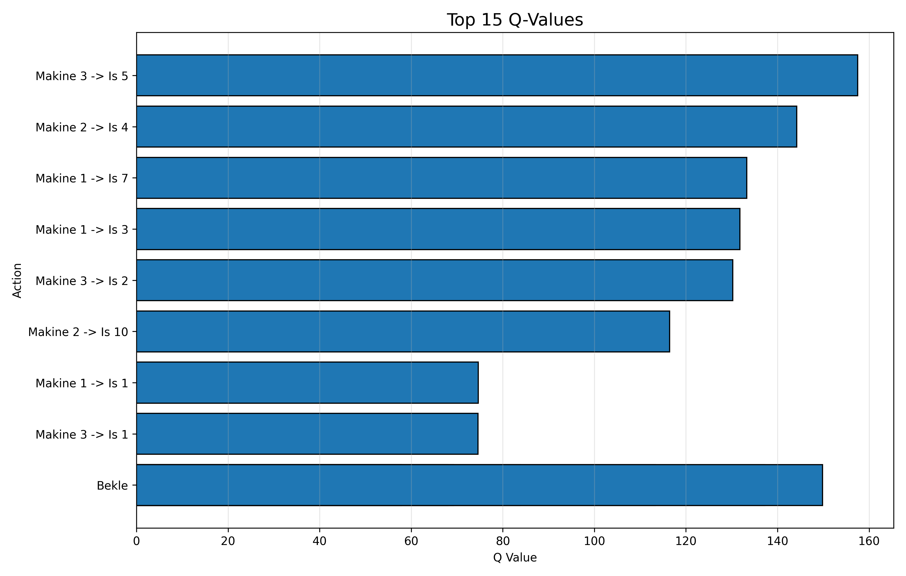
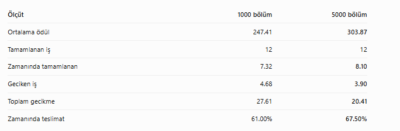
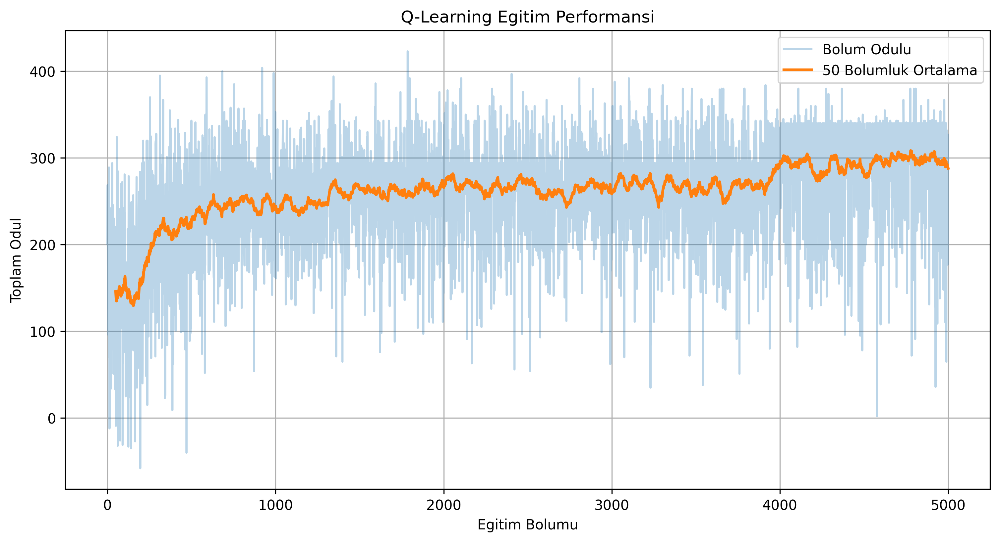
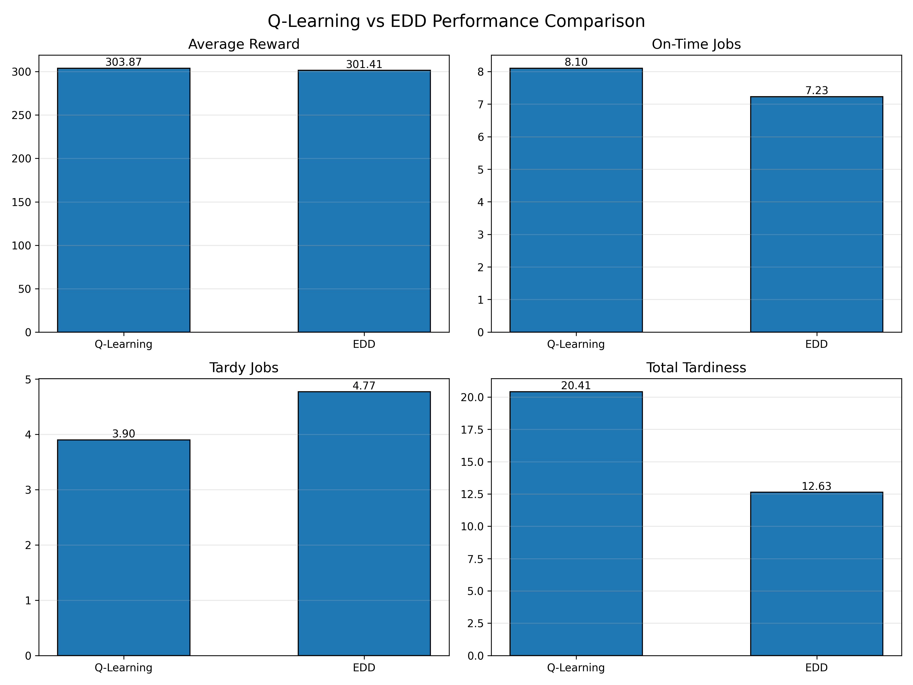
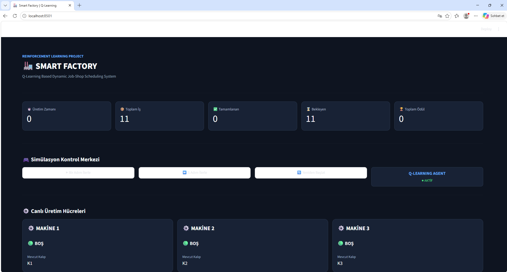
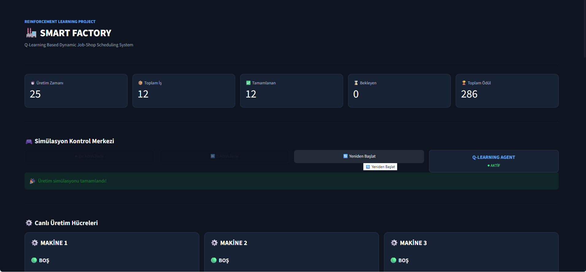
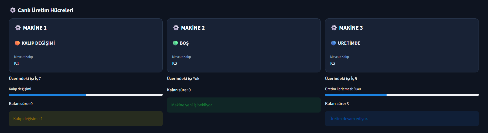
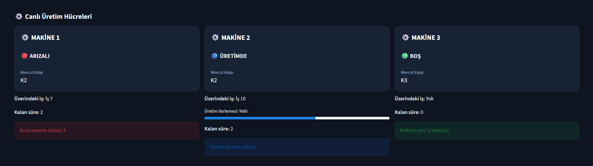

# PEKİŞTİRMELİ ÖĞRENME İLE ESNEK ÜRETİM HÜCRELERİNDE DİNAMİK İŞ ÇİZELGELEME

## 1. Projenin Amacı ve Konusu

Bu projede, esnek üretim sistemlerinde işlerin uygun makinelere dağıtılması ve üretim sırasının belirlenmesi problemi ele alınmıştır. Projenin temel amacı, Q-Learning algoritmasını kullanarak üretim ortamında iş çizelgelemesi yapan bir öğrenen ajan geliştirmektir.

Üretim ortamında makinelerin arızalanması ve acil siparişlerin sisteme eklenmesi gibi beklenmedik durumlar modellenmiştir. Böylece sistemin yalnızca sabit bir üretim planına bağlı kalmadan değişen koşullara göre karar verebilmesi hedeflenmiştir.

Geliştirilen Q-Learning yaklaşımının performansı, geleneksel bir çizelgeleme yöntemi olan EDD (Earliest Due Date) ile karşılaştırılmıştır.

## 2. Kullanılan Teknolojiler

Projenin geliştirilmesinde aşağıdaki araçlardan yararlanılmıştır:

- **Python:** Ortamın ve öğrenme algoritmasının geliştirilmesi.
- **NumPy:** Sayısal işlemler ve Q değerlerinin tutulması.
- **Pandas:** Eğitim ve değerlendirme sonuçlarının kaydedilmesi.
- **Matplotlib:** Performans grafiklerinin oluşturulması.
- **Streamlit:** Üretim ortamının görsel arayüzünün hazırlanması.
- **Pickle:** Öğrenilen Q tablosunun dosyaya kaydedilmesi.

## 3. Üretim Ortamının Oluşturulması (Environment)

Proje kapsamında üç makineden oluşan örnek bir üretim ortamı oluşturulmuştur. Her makine belirli kalıp türleriyle uyumlu olacak şekilde tanımlanmıştır.

Üretim ortamında başlangıçta 11 iş bulunmaktadır. Ayrıca simülasyonun 5. zaman adımında sisteme bir acil sipariş eklenmektedir. Böylece toplam iş sayısı 12 olmaktadır.

İşlerin farklı makinelerde işlenme süreleri ve teslim tarihleri bulunmaktadır. Makinelerin her işi işleyememesi nedeniyle makine-iş uyumluluğu da dikkate alınmıştır.

Ortamda aşağıdaki durumlar modellenmiştir:

- Makinelerin boşta veya çalışıyor olması.
- İşlerin beklemede veya tamamlanmış olması.
- İşlerin teslim tarihlerine göre gecikmesi.
- Makine hazırlık (setup) süreleri.
- Rastgele makine arızaları.
- Sisteme sonradan eklenen acil sipariş.

Makine arızaları belirli bir olasılıkla gerçekleşmekte ve arıza yaşayan makine belirli bir süre üretim yapamamaktadır.

**[EKRAN GÖRÜNTÜSÜ 1: Üretim ortamındaki makineleri ve işleri gösteren kod bölümü]**

## 4. Pekiştirmeli Öğrenme Modelinin Tanımlanması

Projede pekiştirmeli öğrenme yaklaşımı kullanılmıştır. Bu yaklaşımda bir ajan, içinde bulunduğu ortamı gözlemleyerek eylem seçer. Seçtiği eylemin sonucunda bir ödül veya ceza alır ve zaman içerisinde daha iyi kararlar öğrenmeye çalışır.

Bu projede üç temel kavram kullanılmıştır:

### 4.1. State (Durum)

State, ajanın üretim ortamının mevcut durumunu anlamak için kullandığı bilgileri temsil etmektedir.

Durum bilgileri içerisinde:

- Makinelerin mevcut durumları ve kalan çalışma süreleri,
- İşlerin bekleme ve tamamlanma durumları,
- Acil sipariş bilgisi,
- İşlerin teslim tarihlerine kalan süreler,
- Simülasyonun mevcut zamanı

bulunmaktadır.

Son durumda State yapısı 35 elemandan oluşacak şekilde düzenlenmiştir. Böylece ajan, işlerin teslim tarihlerine kalan süreleri de karar verirken dikkate alabilmektedir.

### 4.2. Action (Eylem)

Action, ajanın üretim ortamında gerçekleştirebileceği işlemleri ifade etmektedir.

Projede toplam 37 eylem tanımlanmıştır:

- İlk 12 eylem: 1. makineye iş atama.
- Sonraki 12 eylem: 2. makineye iş atama.
- Sonraki 12 eylem: 3. makineye iş atama.
- Son eylem: Bekleme.

Ajan yalnızca o anda gerçekleştirilebilecek geçerli eylemler arasından seçim yapmaktadır. Böylece uygun olmayan makineye iş atama gibi geçersiz işlemler engellenmektedir.

### 4.3. Reward (Ödül)

Reward, ajanın yaptığı seçimin ne kadar başarılı olduğunu değerlendirmek için kullanılmaktadır.

Projede ödül ve ceza sistemi şu durumlara göre oluşturulmuştur:

- Bir işin tamamlanması: +20 ödül.
- Bir işin zamanında tamamlanması: +20 ek ödül.
- Acil siparişin tamamlanması: +30 ek ödül.
- Geç tamamlanan iş: Gecikme süresine göre ceza.
- Teslim tarihi geçmiş ve tamamlanmamış iş: Her zaman adımında -3 ceza.
- Geçersiz eylem: -15 ceza.
- Makine hazırlık işlemi: -5 ceza.
- Makine arızası: -8 ceza.
- Bekleme: -1 ceza.

Bu ödül sistemiyle ajanın işleri zamanında tamamlaması ve üretim sürecindeki olumsuz durumları azaltması hedeflenmiştir.

**[EKRAN GÖRÜNTÜSÜ 2: State, Action ve Reward tanımlarını gösteren kod bölümleri]**

## 5. Q-Learning Algoritmasının Geliştirilmesi

Projede kullanılan öğrenme algoritması Q-Learning'dir. Q-Learning, ajanın mevcut durumda hangi eylemi seçmesinin daha faydalı olacağını öğrenmesini sağlayan modelden bağımsız bir pekiştirmeli öğrenme yöntemidir.

Ajan, her durum için mümkün olan 37 eyleme ait Q değerlerini bir tabloda saklamaktadır.

Q değerleri başlangıçta sıfır olarak tanımlanır. Eğitim sırasında ajan eylem seçer, ortamdan ödül alır ve Q tablosunu günceller.

Projede kullanılan temel parametreler:

| Parametre | Değer |
|---|---:|
| Learning Rate | 0.1 |
| Discount Factor | 0.95 |
| Başlangıç Epsilon | 1.0 |
| Minimum Epsilon | 0.01 |
| Epsilon Decay | 0.995 |
| Eylem sayısı | 37 |

Eylem seçiminde Epsilon-Greedy yöntemi kullanılmıştır. Bu yöntemde ajan bazen rastgele bir eylem seçerek yeni seçenekleri keşfeder, bazen de öğrendiği Q değerlerine göre en iyi eylemi tercih eder.

Eğitim ilerledikçe epsilon değeri azaltılarak keşif oranı düşürülmüştür.

## Q-Learning Eğitim Süreci

Ajanın 5000 episode boyunca eğitim sürecindeki ödül değişimi aşağıda gösterilmiştir.

  

### Epsilon Decay

Eğitim boyunca keşif oranının azalması.

  

### Top Q-Values

En yüksek Q değerine sahip aksiyon kayıtları.

  

## 6. Modelin Eğitilmesi

Q-Learning ajanı iki farklı eğitim süresiyle test edilmiştir:

- İlk eğitim: 1000 bölüm.
- İkinci eğitim: 5000 bölüm.

Her bölümde üretim ortamı yeniden başlatılmış ve ajan simülasyon tamamlanana kadar kararlar vermiştir. Her bölümün sonunda toplam ödül, tamamlanan iş sayısı, zamanında tamamlanan işler ve toplam gecikme gibi bilgiler kaydedilmiştir.

Eğitim sonunda Q tablosu ve eğitim geçmişi dosyaya kaydedilmiştir.

### 6.1. Eğitim Sonuçları

| Ölçüt | 1000 Bölüm | 5000 Bölüm |
|---|---:|---:|
| Q tablosundaki durum sayısı | 16.468 | 34.282 |
| Son epsilon | 0.01 | 0.01 |
| Son 100 bölüm ortalama ödülü | 250.27 | 292.13 |

5000 bölümlük eğitimde ajanın karşılaştığı farklı durum sayısı artmış ve son 100 bölümün ortalama ödülü yükselmiştir.

### 1000 Episode ve 5000 Episode

  

### Training Reward Curve

  

## 7. Q-Learning ve EDD Yöntemlerinin Karşılaştırılması

Geliştirilen Q-Learning algoritmasının performansını değerlendirmek amacıyla EDD yöntemiyle karşılaştırma yapılmıştır.

EDD (Earliest Due Date), teslim tarihi en yakın olan işin öncelikli olarak seçilmesine dayanan bir çizelgeleme yöntemidir.

Karşılaştırmada her iki yaklaşım da 100 değerlendirme bölümü üzerinden test edilmiştir. Aynı değerlendirme koşullarının kullanılmasıyla yöntemlerin performansları karşılaştırılmıştır.

### 7.1. Karşılaştırma Sonuçları

| Performans Ölçütü | Q-Learning (5000) | EDD |
|---|---:|---:|
| Ortalama ödül | 303.87 | 301.41 |
| Ortalama tamamlanan iş | 12.00 | 12.00 |
| Zamanında tamamlanan iş | 8.10 | 7.23 |
| Geciken iş | 3.90 | 4.77 |
| Ortalama toplam gecikme | 20.41 | 12.63 |
| Zamanında teslimat oranı | %67.50 | %60.25 |

Sonuçlara göre iki yöntem de bütün işleri tamamlamıştır.

Q-Learning, zamanında tamamlanan iş sayısı ve zamanında teslimat oranı bakımından EDD yönteminden daha iyi sonuç vermiştir. Ortalama ödül değeri de Q-Learning için daha yüksek çıkmıştır.

Bununla birlikte EDD, toplam gecikmeyi azaltma konusunda daha başarılı olmuştur. Bu nedenle Q-Learning'in bütün performans ölçütlerinde üstün olduğu söylenemez.

Elde edilen sonuçlar, Q-Learning'in öğrenme yoluyla üretim ortamına uyum sağlayabildiğini ve bazı performans ölçütlerinde geleneksel EDD yönteminin üzerine çıkabildiğini göstermektedir.

Q-Learning ve EDD algoritmalarının performans karşılaştırması.

  

## 8. Streamlit Arayüzünün Geliştirilmesi

Geliştirilen sistemin daha kolay gözlemlenebilmesi ve simülasyonun görsel olarak takip edilebilmesi amacıyla Streamlit kullanılarak bir arayüz hazırlanmıştır.

Arayüz üzerinden:

- Üretim ortamındaki makinelerin durumları takip edilebilmektedir.
- Makinelerin boşta, çalışıyor veya arızalı olma durumları görüntülenebilmektedir.
- İşlerin bekleme ve tamamlanma durumları incelenebilmektedir.
- Simülasyon adım adım ilerletilebilmektedir.
- Birden fazla zaman adımı birlikte çalıştırılabilmektedir.
- Ajanın seçtiği kararlar görüntülenebilmektedir.
- Acil siparişin sisteme eklenmesi takip edilebilmektedir.

Bu arayüz sayesinde üretim ortamındaki değişiklikler ve Q-Learning ajanının kararları daha anlaşılır hâle getirilmiştir.

  

  

  

  

## 9. Genel Değerlendirme ve Sonuç

Bu projede, esnek üretim hücrelerinde dinamik iş çizelgeleme problemi pekiştirmeli öğrenme yaklaşımıyla ele alınmıştır. Üç makine ve toplam 12 işten oluşan örnek bir üretim ortamı oluşturulmuş; makine arızaları ve acil sipariş gibi değişken durumlar sisteme eklenmiştir.

Q-Learning algoritması kullanılarak üretim ortamında karar verebilen bir ajan geliştirilmiştir. Eğitim süresinin artırılmasının performansa etkisi incelenmiş ve 5000 bölümlük eğitimin 1000 bölümlük eğitime kıyasla daha iyi sonuçlar verdiği görülmüştür.

EDD yöntemiyle yapılan karşılaştırmada Q-Learning, zamanında teslimat oranını %67.50 seviyesine çıkararak EDD'nin %60.25 değerinin üzerine çıkmıştır. Ancak toplam gecikme bakımından EDD daha başarılı olmuştur.

Sonuç olarak proje, pekiştirmeli öğrenmenin dinamik üretim çizelgeleme problemlerinde kullanılabileceğini göstermektedir. Bununla birlikte mevcut çalışma sınırlı sayıda makine ve iş içeren simülasyon ortamında gerçekleştirilmiştir. Gelecekte daha fazla makine ve iş içeren ortamlar, farklı arıza senaryoları ve daha gelişmiş öğrenme algoritmaları kullanılarak sistem geliştirilebilir.